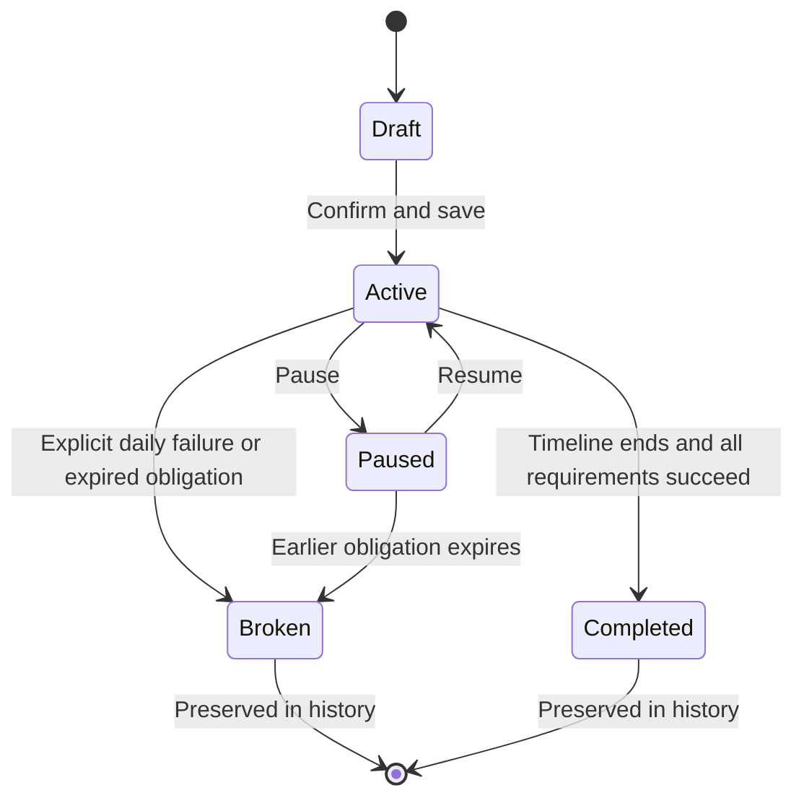

# LockIn — Commitment Behavior

Last updated: 16 October 2026. Phase 1 contract, implemented locally through Phase 6.

## Confirmed choices versus implementation defaults

The user confirmed a **24-hour catch-up window** for unlogged scheduled work and **pauses that freeze progress and extend the deadline**. The detailed edge-case rules below are implementation defaults selected to make those decisions consistent. They can be revised through an explicit product change recorded in `phases.md`.

## Time and duration

- Store an IANA time zone on each attempt when it is locked. Use that zone to define its calendar dates, due times, and reminders. Traveling does not silently change an existing attempt's day boundaries.
- Store event timestamps as UTC instants and logical check-in dates separately. Never group check-ins solely by the device's current time or a UTC date string.
- Duration N means N nonpaused calendar dates, including the start date. Rest weekdays in Custom Days still consume calendar duration; paused dates do not.
- Without pauses, end date = start date plus N minus 1 calendar days. The first active date displays Day 1 / N; before the start, show Day 0 / N. Never display Day N+1 / N during catch-up.
- The references contain inconsistent example dates: a 45-day attempt starting June 4, 2026 ends July 18 under this inclusive rule. Generate dates from the rule rather than reproducing sample arithmetic.
- The end of date D is the start of D+1 in the attempt's zone. Its catch-up deadline is that instant plus exactly 24 hours. This is elapsed time, including when a daylight-saving change makes local dates shorter or longer.
- A daily obligation is incomplete, not broken, while its catch-up window remains open. A reminder or a phone background task is not the authority for breaking a commitment; evaluate overdue work on the backend and reconcile on read/logging.

## Pace and daily logging

| Pace | What is due | Success rule |
| --- | --- | --- |
| Everyday | One binary outcome on each nonpaused date | Build marked Done or Quit marked Stayed Consistent |
| Flexible / Day | Build: N repetitions per nonpaused date; Quit: one binary outcome | Saved count reaches N, or Quit consistency is recorded |
| Custom Days | One binary outcome on selected weekdays within the nonpaused timeline | Each due date is successful; other dates are rest days |
| Flexible / Week | N successful distinct dates per seven nonpaused calendar dates, anchored at attempt start | Each period meets its quota; multiple repetitions on one date count as one successful date |

Weekly periods are attempt periods, not Monday-to-Sunday calendar weeks. Show their start/end dates in logging/detail context. A pause suspends the period; resume continues its remaining dates. For the final period with d < 7 dates, required successes = ceil(N × d / 7); show this adjusted target before lock and in the review summary when relevant.

Daily logs may be added or corrected until that date's catch-up deadline. For a weekly quota, an unsuccessful or unlogged date does not itself break the attempt. Evaluate the period after its final date's catch-up deadline; it breaks only if the quota is still short. A catch-up entry still belongs to its original date and cannot move a success from a later period into an earlier one. Older dates whose own edit window has closed are read-only.

Future dates, rest dates, and paused dates cannot receive a success log. Multiple taps update the same logical record; they do not create duplicate credit. Numeric saves set an absolute count rather than incrementing on each retry.

## Failure and catch-up

- For Everyday, Custom Days, or a daily count, explicitly recording Missed/Broken ends the attempt immediately after confirmation. The 24-hour grace is for missing or incomplete logs, not for overriding a confirmed failed outcome.
- An unresolved daily obligation becomes broken at its catch-up deadline. Save the due date as the failure date and the processing time separately so history remains accurate.
- A partial daily count can be increased during catch-up. At expiry, a short count is a missed obligation.
- Weekly unsuccessful dates remain part of the period history. They break the attempt only when the period expires below quota.
- If a past obligation expires while the attempt is paused, the attempt becomes Broken. Pausing does not erase an existing obligation or its deadline.
- Once broken, preserve all logs, counts, events, and notes. Further progress belongs to a new attempt, not an overwrite of the failed one.

## Pause and resume

To retain existing logs and avoid deleting part of a day, a pause stops reminders immediately and **freezes the schedule from the next local calendar date**. The confirmation states: Pause from tomorrow; today's target still counts. The card changes to Paused immediately, but any current-day or catch-up obligation remains accessible in tracking/history.

Pause is available only when at least one planned active date remains after today. For a future-start attempt, pausing is not offered until it starts. No progress or obligations accrue during the paused date interval.

Resume reactivates the current local date. The frozen interval includes pause-start date and excludes resume date. Extend the schedule by the number of dates in that interval. A same-day pause/resume before the freeze begins adds zero days. Repeated pauses add their nonoverlapping intervals; preserved logs never move to different dates.

While paused, the detail timeline displays the frozen day number and Paused since [date]. Label the old end date as Original end, with Deadline extends on resume. On resume, show the recomputed end date and recreate future reminders. This avoids presenting an unknowable final end date as fixed during an indefinite pause.

## State transitions

Restart creates a **new Active attempt** linked to the old Broken attempt; the diagram's Broken state is terminal for that old attempt. A future start is an Active attempt with a future start date, not a separate status. Draft is local creation state and does not appear in the committed dashboard.

| Event | Preconditions | Persisted result |
| --- | --- | --- |
| Lock | Valid draft, authenticated owner | Fixed definition, first attempt, start event, unique request ID |
| Save check-in | Owner, applicable date, edit window open, attempt not terminal | One log per attempt/date; count/result updated atomically |
| Pause | Active, started, future planned dates remain | Pause event and freeze start; no deletion of past logs |
| Resume | Paused, not subsequently broken | Close frozen interval, recompute timeline, resume event |
| Fail | Confirmed daily failure or expiry below requirement | Broken status plus logical failure date and reason |
| Restart | Broken; no newer current attempt already created | New linked attempt with same locked rules, start today, empty progress; old attempt retained |
| Complete | Planned active dates have ended and all requirements satisfied | Completed status, completion event, reward unlocked |

Apply transitions and related records in one database transaction. Ownership checks, unique keys, and request IDs prevent duplicate or unauthorized transitions. A retry of Lock or Restart must return the already-created result, not create a second attempt.

## Completion, progress, and reward

- Completing today's action fills today's progress, not the whole challenge timeline. The timeline tracks the current unpaused calendar-day ordinal.
- The attempt completes after its final planned date has ended and all daily/period requirements are successful. If logs are outstanding but still within grace, retain Active with Awaiting final check-in; do not unlock the reward early.
- If all requirements are already satisfied, completion need not wait for unused catch-up time after the end date. Otherwise evaluate on a valid catch-up save or deadline expiry.
- Active streak = consecutive successful due dates for daily/custom modes; completed quota periods for weekly mode. Paused and rest dates neither add to nor break the streak. Unresolved dates prevent extension until resolved. Label units clearly; do not compare weekly period streaks to daily streaks as if they were identical.
- Reward is a self-chosen motivation. Unlocking displays it as earned; the app does not purchase, fulfill, or verify redemption.
- Completed attempts appear in History. The current Focus list excludes them; the empty state offers a new commitment when no current attempts remain.

## Reflection and restart

Breaking an attempt opens reflection when caused by an explicit user action. Automatic expiry shows the Broken card and a reflection/restart action at next use; do not unexpectedly open a modal over unrelated work.

A reflection can contain one preset reason or a custom note of up to 500 characters. It is private and optional. Secure Log & Restart saves it on the failed attempt and creates the new attempt atomically. Skip reflection can restart with an empty note. Returning later to a saved broken attempt must not duplicate its replacement attempt.

The commitment definition becomes immutable once locked. Restart reuses its path, target, duration, pace, time zone, and reward. Changing those rules requires a new commitment through the wizard. Preserve the link between attempts so History can show the full story.

## Connectivity and private data

Initial release baseline: cache the last loaded dashboard/history for reading and retain the unsaved creation draft locally per account. Writes require connectivity. An unsuccessful/offline write keeps the modal/draft input and displays Not saved — reconnect and retry; it must not display a committed checkmark, unlock, or success haptic.

A full offline write queue is deferred. This is an explicit implementation default, not an assumed Supabase feature. Catch-up remains governed by the backend deadline; show the user the deadline when saving is unavailable. Recheck overdue status before applying a retry.

For the Phases 2–4 test round, the user explicitly chose local testing before cloud connection. Continue on this device uses authoritative local storage, including offline local saves. Cloud accounts retain the online-save policy above. Local data is separate from cloud accounts; no guest-to-cloud migration or offline cloud write queue is implemented.

RLS restricts commitments, attempts, logs, lifecycle events, and reflections to their owner. Server-side transition functions validate ownership and state; the mobile client never receives a privileged service key. Clear per-account cached data and local drafts on sign-out. Technical errors and private reflections must not be copied into routine diagnostic logs.

## Conceptual records for Phase 2

| Record | Purpose |
| --- | --- |
| Profile | Owner, display name, default time zone, preferences |
| Commitment | Immutable locked definition, reward, owner |
| Attempt | Start/end calculation, duration, fixed time zone, status, previous attempt link |
| Check-in | Attempt + logical date unique key; binary outcome or absolute count; edit timestamps |
| Pause interval / event | Effective local dates and UTC event timestamps; auditable state changes |
| Reflection | Failed attempt, optional reason/note; private owner access |

Exact schema, migrations, indexes, and server implementation belong to Phase 2 onward. This specification defines the behavior they must preserve.

## Acceptance examples for implementation

| Case | Expected result |
| --- | --- |
| 7 days starting June 4 | Day 1 June 4, Day 7 June 10; completes after June 10 ends when requirements are satisfied |
| Unlogged June 4 in Asia/Kolkata | Catch-up through June 5; expires at June 6 00:00 local, using the defined 24-hour rule |
| June 4 logged on June 5 | Credits June 4 only; June 5 remains separately due |
| Daily count 3/10 | Partial progress; 10/10 required by expiry; retries never add unintended counts |
| Explicit daily Missed | Confirmation, Broken immediately, reflection offered, old logs preserved |
| Custom Monday/Wednesday, missed Tuesday | Tuesday is a rest date and creates no failure |
| Weekly target 3, seven-date period | Three different successful dates required; repeated entries on one date count once |
| Final three-date weekly period at target 3/7 | ceil(3 × 3/7) = 2 successes required, disclosed before lock |
| June 4 start, pause June 6, resume June 9, N=7 | June 7–8 frozen; June 6 still due; end shifts from June 10 to June 12 |
| Pause/resume on June 6 before freeze begins | No paused dates or extension; preserve June 6 progress |
| Earlier overdue date expires while paused | Broken; pausing does not grant extra catch-up time |
| Final day pending within grace | Day N/N, Awaiting final check-in, reward remains locked |
| Restart tapped twice | Exactly one new linked attempt; old failed attempt remains in History |
| Connection fails during lock/log | No success claim; input retained; retry resolves the same request |
| Another user requests private history | Access denied by database ownership policy |
| Travel changes device zone | Existing attempt dates remain tied to the attempt's stored zone |

These are acceptance cases to turn into focused tests when their behavior is implemented. No application behavior was tested in Phase 1 because no application exists yet.

## Implementation boundary after Phase 6

The lifecycle contract is now implemented in the local repository with serial atomic writes and reconciliation before/after mutations and on reads. A foreground refresh runs every 30 seconds. When the app was closed across an expiry, the next read records Broken using the missed logical date and the processing instant. Completion follows the same reconciliation path. Tests inject clocks to verify exact boundaries without changing the user's real device clock.

Clerk is the selected future identity provider; Supabase remains the planned database. Server-time enforcement, transactional RPCs and scheduled cloud expiry are deferred until connection after Phase 6. The old Supabase Auth SQL/client are undeployed legacy preparation, not the current cloud contract. Local reflections are stored only on this device; no cloud privacy guarantee or encryption-at-rest claim is made by this test mode.

Reminders are derived from saved state, never authoritative. Native requests are cancelled/rescheduled as eligible dates change, with a bounded rolling horizon that stops before unresolved expiry. See [testing](testing.md) for notification timing, permission and device checks.
